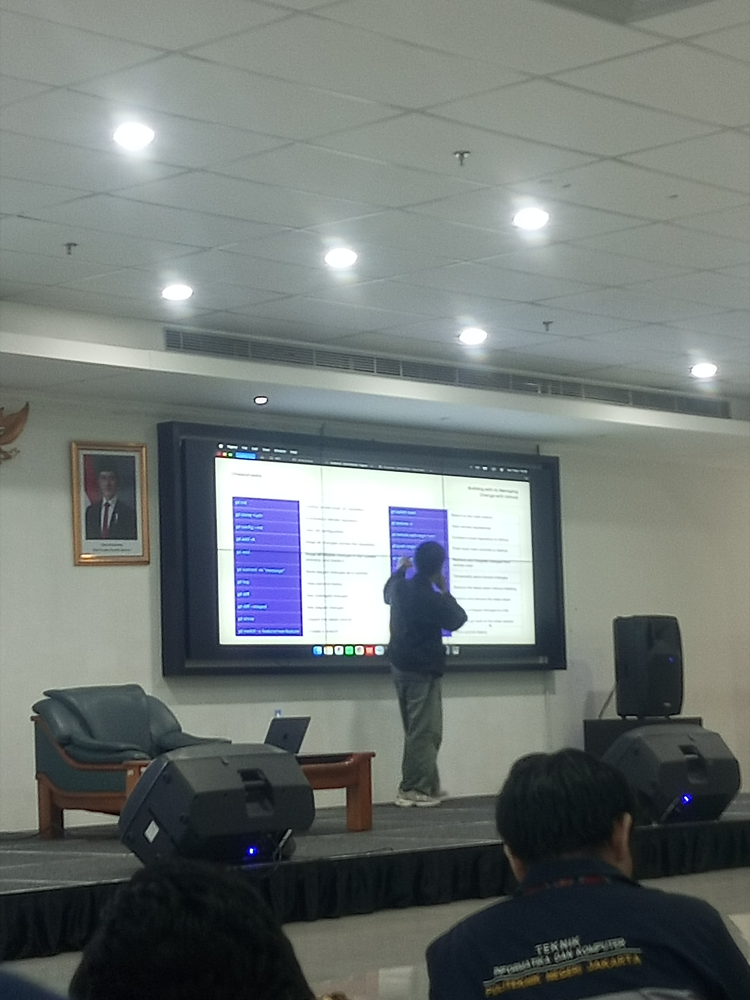
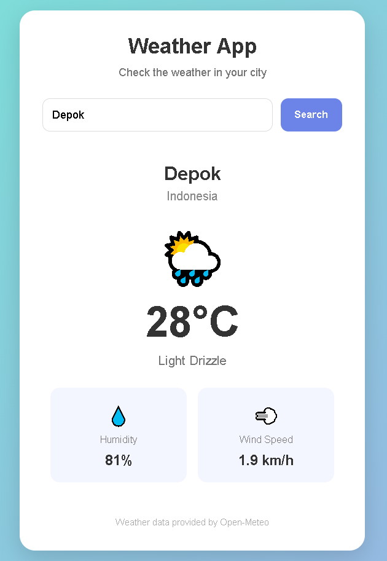

# Weather Report

**Nama Lengkap:** Muhammad Zaki Zein  
**Kelompok:** 12 Uncharted

## Deskripsi Repository
Repository ini berisi aplikasi web sederhana bernama "Weather Report" yang dibuat dengan bantuan Artificial Intelligence (AI) menggunakan HTML, CSS, dan JavaScript.

Aplikasi ini memungkinkan pengguna mencari informasi cuaca berdasarkan nama kota dan menampilkan informasi seperti suhu, kondisi cuaca, kelembapan, serta kecepatan angin.

## Tujuan
Membantu pengguna memperoleh informasi kondisi cuaca dari berbagai kota melalui aplikasi web sederhana. Proyek ini juga menjadi sarana praktik pemanfaatan AI dalam pengembangan aplikasi, penerapan Prompt Engineering, serta penggunaan Git dan GitHub sebagai Version Control System.

## Kegiatan Workshop
Repository ini merupakan bagian dari dokumentasi Day 1 Workshop **"Building with AI, Managing Change with GitHub"**. Dalam kegiatan ini, peserta mempelajari cara memanfaatkan AI untuk membantu pembuatan aplikasi, menyusun prompt yang efektif, serta menggunakan Git dan GitHub untuk mengelola perubahan proyek.

Dokumentasi lengkap kegiatan workshop terdapat pada bagian berikut.

---

## Dokumentasi Workshop Day 1

### 1. Rangkuman Materi

- **Prompt Engineering:** Cara merancang instruksi agar AI memberikan jawaban yang tepat, relevan, dan layak digunakan. Struktur prompt yang baik terdiri dari Role, Task, Context, dan Format.
- **Git vs GitHub:** Git merupakan Version Control System (DVCS) untuk melacak dan mengelola perubahan kode secara lokal. Sementara itu, GitHub merupakan platform berbasis web untuk menyimpan repository Git secara online dan mendukung kolaborasi.
- **Git Workflow:** Proses pengelolaan perubahan file melalui Working Directory, Staging Area, dan Git Directory (Repository).
- **Perintah Penting Git:** `git init`, `git add .`, `git commit -m`, `git remote add`, `git push`, `git pull`, dan `git clone`.
- **Setup Git:** Melakukan instalasi Git, mengatur identitas pengguna, menyiapkan Visual Studio Code, serta mengenal penggunaan SSH Key untuk menghubungkan komputer dengan GitHub.
- **Praktik Proyek:** Membuat aplikasi sederhana menggunakan bantuan AI, mengelola proyek menggunakan Git, kemudian melakukan commit dan push ke GitHub.

### 2. Poin Penting / Hal Baru yang Dipelajari

- Prompt yang spesifik dan memiliki konteks yang jelas dapat membantu AI menghasilkan output yang lebih sesuai dengan kebutuhan pengguna.
- Struktur prompt yang terdiri dari Role, Task, Context, dan Format membantu menyusun instruksi secara lebih terarah.
- Git dan GitHub memiliki fungsi yang berbeda. Git digunakan untuk mengelola riwayat perubahan proyek, sedangkan GitHub digunakan untuk menyimpan repository secara online.
- Staging Area merupakan tempat untuk mempersiapkan perubahan sebelum disimpan melalui proses commit.
- Commit berfungsi sebagai catatan perubahan pada proyek sehingga riwayat pengembangan dapat dikelola dengan lebih terstruktur.
- GitHub memudahkan penyimpanan dan pengelolaan proyek sehingga file dapat diakses kembali secara online.

### 3. Pendapat Pribadi tentang Day 1 Proyek Workshop

Menurut saya, kegiatan Day 1 Workshop memberikan pengalaman dan pengetahuan baru mengenai pemanfaatan Artificial Intelligence (AI) dalam proses pengembangan aplikasi. Saya mendapatkan pemahaman bahwa penggunaan AI tidak hanya sebatas memberikan perintah, tetapi juga membutuhkan penyusunan prompt yang jelas dan terstruktur agar hasil yang diperoleh sesuai dengan kebutuhan. Melalui kegiatan praktik, saya mencoba menerapkan materi tersebut dengan membuat aplikasi Weather Report yang dapat menampilkan informasi cuaca berdasarkan kota yang dicari pengguna.

Selain itu, saya juga mempelajari penggunaan Git dan GitHub untuk mengelola serta menyimpan perubahan proyek. Hal yang cukup menantang bagi saya adalah memahami alur kerja Git, terutama penggunaan staging area, commit, dan push. Namun, materi tersebut memberikan pemahaman baru tentang pentingnya version control dalam pengembangan aplikasi. Ke depannya, saya ingin menerapkan penggunaan AI, Git, dan GitHub dalam mengembangkan proyek-proyek lainnya agar proses pengerjaan menjadi lebih terstruktur dan mudah dikelola.